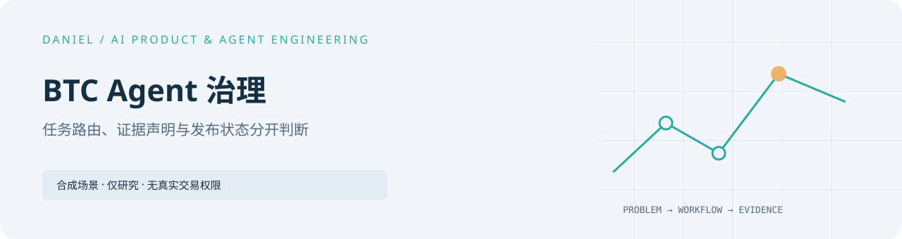
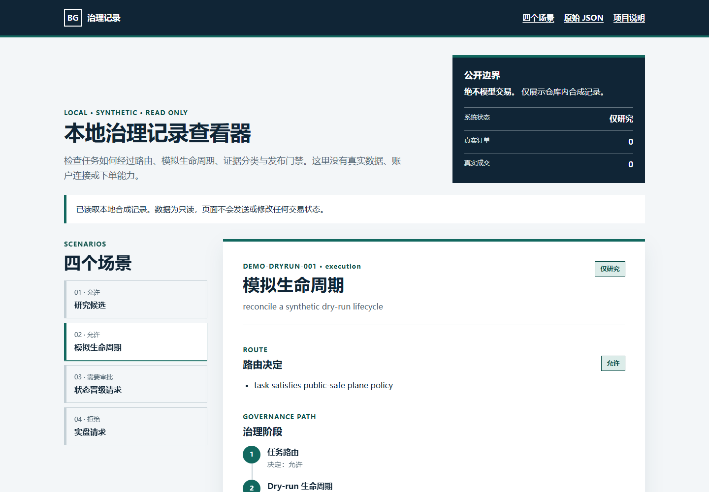

<picture>
  <source media="(prefers-color-scheme: dark)" srcset="docs/assets/cover-dark.svg" />
  
</picture>

# BTC Agent Governance



[UI verification (Chinese)](docs/UI_QA.md)

[Portfolio](https://github.com/Daniel-24-life/AIfile)

[中文](README.md) · [Portfolio](https://github.com/Daniel-24-life/AIfile)

A runnable reference for bounded task routing, dry-run lifecycle, evidence claims
and promotion checks. Four synthetic scenarios end in research-only or blocked
states; execution authority remains false and real orders/fills remain zero.


## Run

Python 3.11+, from the repository root:

```sh
python public_demo.py
python public_demo.py --json
python -m pip install -r requirements-dev.txt
python -B -m pytest tests -q
```

### Local static record viewer

From the repository root, start Python's local static server:

```sh
python -m http.server 8000
```

Then open <http://localhost:8000/demo/>. The viewer defaults to
`dry_run_lifecycle` and lets you inspect all four synthetic scenarios, routing,
governance stages, reasons, evidence, and the original JSON. It only fetches
the repository's `sample.fake.json`: there are no external network dependencies,
account connections, strategy generation, or model trading.

Read the [architecture](docs/architecture.md), [source guide](docs/SOURCE_READING_GUIDE.md),
[viewer UI audit](docs/UI_AUDIT.md), [verification](docs/VERIFICATION.md) and
[synthetic JSON](sample.fake.json).
Deep documentation is in Chinese; identifiers and output retain their code names.

The package includes public governance patterns, not strategy logic, market
research, credentials, backtests, real results or exchange connectivity.
[Migration provenance](MIGRATION.md) identifies the previously public source.
