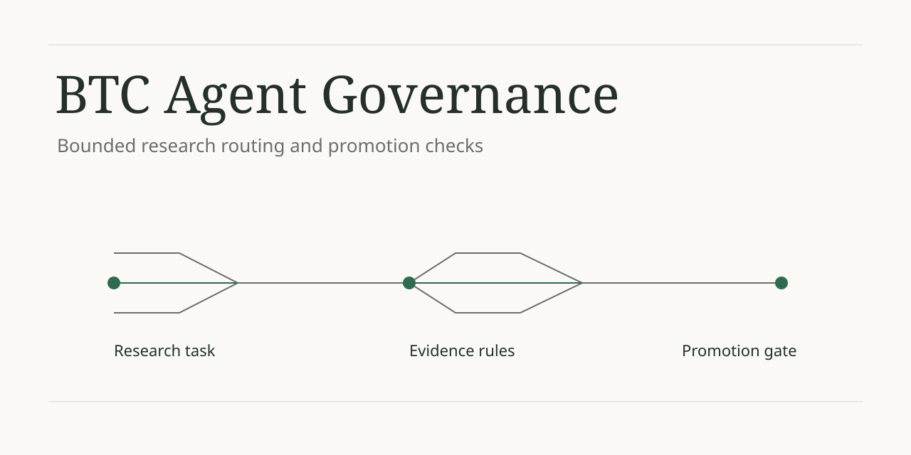
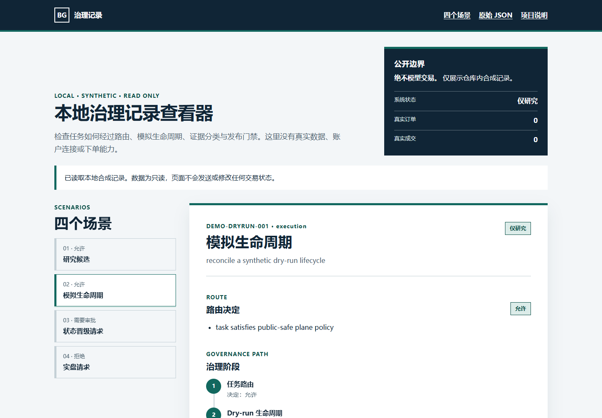
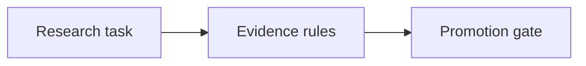

<picture>
  <source media="(prefers-color-scheme: dark)" srcset="docs/cover-dark.svg" />
  <source media="(prefers-color-scheme: light)" srcset="docs/cover-light.svg" />
  
</picture>

# BTC Agent Governance

Route research requests, check evidence declarations, and make review gates visible before a state can advance.

[▶ Live demo](https://daniel-24-life.github.io/btc-agent-governance/) · [中文](README.zh.md) · [](https://github.com/Daniel-24-life/btc-agent-governance/actions/workflows/verify.yml) · [MIT](LICENSE) · Python 3.11+

## Demo



## Problem

A research agent can receive requests that exceed its permissions. It needs a testable policy for deciding what to run and which evidence qualifies for review.

## What I built

- Route requests to a permitted research path.
- Classify evidence declarations against explicit boundaries.
- Exercise promotion decisions with four bundled cases.
- Inspect the resulting records in a static viewer.

## How it works



## Run in 60 seconds

```sh
python -B public_demo.py
python -m http.server 4180 --bind 127.0.0.1
```

Once the local server starts, open [http://127.0.0.1:4180/demo/](http://127.0.0.1:4180/demo/).

## Tests

**28 tests passed.** [Verified GitHub Actions run](https://github.com/Daniel-24-life/btc-agent-governance/actions/runs/45105682528).

```sh
python -m pytest tests -q
```

## Repository layout

| Path | Contents |
| --- | --- |
| [`orchestrator/`](orchestrator/) | Task routing |
| [`governance/`](governance/) | Evidence and promotion rules |
| [`execution/`](execution/) | Dry-run steps |
| [`demo/`](demo/) | Static record viewer |

Reference material · [architecture.md](docs/architecture.md) · [VERIFICATION.md](docs/VERIFICATION.md)

<sub>Demo data is synthetic; modeled on real-world workflows. This repository covers research governance and has no trading or exchange execution path.</sub>
