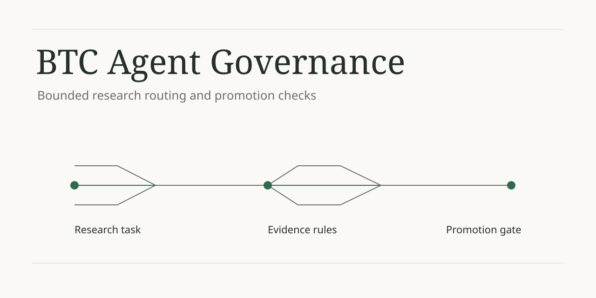
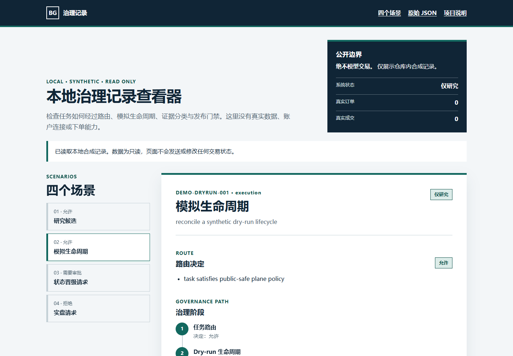
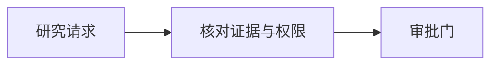

<picture>
  <source media="(prefers-color-scheme: dark)" srcset="docs/cover-dark.svg" />
  <source media="(prefers-color-scheme: light)" srcset="docs/cover-light.svg" />
  
</picture>

# BTC 研究 Agent 治理

用任务路由、证据判断和晋级门禁约束研究请求。

[在线演示](https://daniel-24-life.github.io/btc-agent-governance/) · [English](README.md) · [](https://github.com/Daniel-24-life/btc-agent-governance/actions/workflows/verify.yml) · [MIT](LICENSE) · Python 3.11+

## Demo



## 要解决的问题

研究请求会引入不同来源和权限。决策前需要看清证据缺口，并检查请求是否超出研究范围。

## 实现

- 把请求分配到允许的研究路径。
- 核对证据声明及状态变更前提。
- 在浏览器查看四组示例记录。

## 工作流程



## 快速运行

```sh
python -B public_demo.py
python -m http.server 4180 --bind 127.0.0.1
```

启动后打开 [http://127.0.0.1:4180/demo/](http://127.0.0.1:4180/demo/)。

## 测试

实测 **28 项通过**。[通过的 GitHub Actions 运行](https://github.com/Daniel-24-life/btc-agent-governance/actions/runs/45105682528)。

```sh
python -m pytest tests -q
```

## 仓库目录

| 路径 | 内容 |
| --- | --- |
| [`orchestrator/`](orchestrator/) | Task routing |
| [`governance/`](governance/) | Evidence and promotion rules |
| [`execution/`](execution/) | Dry-run steps |
| [`demo/`](demo/) | Static record viewer |

延伸阅读 · [architecture.md](docs/architecture.md) · [VERIFICATION.md](docs/VERIFICATION.md)

<sub>使用模拟研究场景与夹具。公开演示权限为 research_only。</sub>
